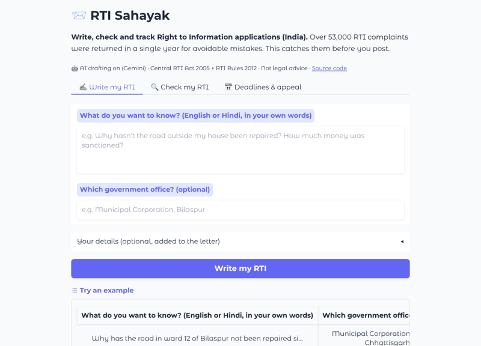

<div align="center">

# 📨 RTI Sahayak

**Write, check and track Right to Information applications (India).**
Type what you want to know in plain English or Hindi. Get an RTI that a Public Information Officer has to answer.

[](https://github.com/NatikChhabra/rti-sahayak/actions/workflows/ci.yml)
[](https://huggingface.co/spaces/Natik22may/rti-sahayak)
[](LICENSE)




</div>

## The gap

India's RTI Act lets any citizen get copies of government records for ₹10. But the system rejects a huge amount of what people send:

- **53,000+ RTI complaints were returned in a single year** for procedural reasons ([Deccan Herald](https://deccanherald.com/india/more-than-53000-rti-complaints-returned-in-one-year-maharashtra-tops-list-3230372)).
- **About 3.85 lakh appeals are pending** with information commissions, and returned appeals are flagged as a procedural hurdle ([ThePrint](https://theprint.in/india/rti-at-21-3-85-lakh-cases-pending-procedural-hurdles-flagged-in-returned-appeals/3070554/)).

Most of these mistakes are small and predictable: no fee, letters not addressed to the PIO, "why" questions that the law doesn't require anyone to answer, RTIs sent to private banks, or demands for action instead of requests for records. A first-time applicant has no way to know. RTI Sahayak catches these mistakes before the letter is posted.

## What it does

| | |
|---|---|
| ✍️ **Write my RTI** | Describe your problem in your own words. An LLM (Gemini or Claude) turns it into a formal application. It rewrites "why" and "when will" questions as requests for records, removes demands for action, and sends questions about private companies to the right regulator (RBI, TRAI, RERA…). |
| 🔍 **Check my RTI** | Paste any RTI. It flags **15 common mistakes**, each with a plain-language reason, a fix, and the section of the law it comes from. |
| 📅 **Deadlines & appeal** | Enter your filing date. It shows when the reply is due (30 days, 35 via an APIO, 40 with third parties, 48 hours for life or liberty), whether it is now a deemed refusal, the first and second appeal windows, and it drafts your first appeal. |

Works in **English and Hindi**. No sign-up. Your text is not stored.

## How it works

```
 your words ──► LLM: Gemini or Claude (structured output: authority, subject, points, period…)
                   │
                   ▼
              rule checker ──► problems found? ──► the LLM fixes them (1 repair round)
                   │                                         │
                   ▼                                         ▼
              letter template (English / Hindi) ──► final checker report shown to you
```

- **The checker is plain Python rules, not AI.** It is fast, free, testable and explainable, and every flag cites the Act or Rules. It also acts as the **judge** for the AI drafter.
- **The AI drafter** asks an LLM for structured output: it fills a typed `Draft` schema ([Gemini JSON schema](https://ai.google.dev/gemini-api/docs/structured-output) or [Claude structured outputs](https://platform.claude.com/docs/en/build-with-claude/structured-outputs)) rather than writing free text, so the letter format is always correct. The checker then reviews the draft, and if it finds problems the model gets one chance to fix them (*generate → verify → repair*). Both providers sit behind one small interface, so swapping models is one environment variable.
- **No API key? It still works.** A rule-based offline drafter takes over, and the eval below compares the two.

| AI engineering skill | Where it is in the code |
|---|---|
| Structured output with a typed schema | `rti_sahayak/drafter.py` → `Draft`, `draft_with_ai` |
| Provider-agnostic LLM layer (Gemini + Claude) | `_GeminiBackend`, `_ClaudeBackend`, `ai_provider` |
| Verifier-in-the-loop (generate → check → repair) | `draft_with_ai` + `content_issues` |
| Evals with a dev set and a held-out set | `evals/` |
| Graceful fallback when the model fails or refuses | `rti_sahayak/web.py` → `on_draft` |
| Testing LLM code without API calls (fake client) | `tests/test_drafter.py` |
| Deploying a no-sign-up web demo | `rti_sahayak/web.py` (Gradio), `deploy/` |

## Evals

```bash
python evals/run_checker_eval.py                      # dev set
python evals/run_checker_eval.py heldout_cases.jsonl  # held-out set
python evals/run_drafter_eval.py [--ai]               # drafters, judged by the checker
```

**Checker** (does it flag the right mistakes?)

| Set | Cases | Result | Notes |
|---|---|---|---|
| Dev set (`checker_cases.jsonl`) | 30 | 30/30 exact, precision 1.00, recall 1.00 | Written while building the checker, so the score is optimistic. |
| Held-out set (`heldout_cases.jsonl`), **first run** | 20 | **17/20 exact, precision 0.94, recall 0.89** | Written separately, without seeing the code. This is the honest number. |
| Held-out set after fixes | 20 | 20/20 | Fixed three real gaps: "private unaided" schools, a person's *own* ITR wrongly flagged as third-party, and Hindi custody words (हिरासत, गिरफ्तार). The set has been seen now, so it is no longer truly held out. |

**Drafter** (does each draft come out as a valid RTI?) on 15 realistic needs: why/when questions, grievances, private banks, Hindi, an arrest, and others.

| Drafter | Pass |
|---|---|
| Offline (rules only) | 12/15 |
| LLM + checker repair loop | Run `python evals/run_drafter_eval.py --ai` (≈15–30 API calls, fine on Gemini's free tier) |

The offline drafter fails on private companies (it can only warn you; it can't pick the regulator) and on vague requests. Those are the cases the AI drafter exists for. Note that a "pass" only means the checker found no rule breaks. It doesn't prove the letter is *useful*, which is why a human or LLM judge is the next step (see Limits).

## Run it yourself

```bash
git clone https://github.com/NatikChhabra/rti-sahayak && cd rti-sahayak
pip install -r requirements.txt
python app.py                         # open http://127.0.0.1:7860
```

For AI drafting, set **`GEMINI_API_KEY`** (default model `gemini-3.8-flash`, change it with `RTI_GEMINI_MODEL`) or `ANTHROPIC_API_KEY` (default `claude-opus-5-5`, change it with `RTI_CLAUDE_MODEL`). If both are set, Gemini is used unless `RTI_AI_PROVIDER=claude`. Run the tests with `pip install -r requirements-dev.txt && pytest`.

Use it from Python:

```python
from rti_sahayak import check, timeline

report = check(open("my_rti.txt").read())
print(report.risk, [i.title for i in report.issues])
print(timeline("2026-10-01").advice)
```

## Project layout

```
rti_sahayak/
  rules.py       every fee, limit and deadline, with its section of the Act/Rules
  checker.py     15 checks → Report(risk, issues)
  drafter.py     AI drafter (Gemini/Claude), offline drafter, English/Hindi letter + first-appeal templates
  deadlines.py   reply / first appeal / second appeal timeline
rti_sahayak/web.py  Gradio web app (app.py just starts it)
tests/           63 unit tests (no network needed)
evals/           checker dev + held-out sets, drafter eval
```

## Limits (please read)

- **Not legal advice.** It is general guidance based on the RTI Act, 2005 and the central RTI Rules, 2012.
- **Central rules only.** States set their own fees and formats (some charge more, some require one subject per application). The checker uses the central ₹10 fee, so check your state's RTI rules.
- **The checker uses rules, not understanding.** It looks for patterns. An unusual phrasing can slip past, and an innocent sentence can occasionally get flagged. Real held-out precision and recall were 0.94 and 0.89 before fixes.
- **The eval sets are small and synthetic.** They are 50 hand-written cases modelled on common mistakes, not real filed RTIs. The next step is a set of real (anonymised) RTIs with their actual outcomes.
- **The AI can guess the wrong office.** When it guesses, the app tells you to confirm the PIO address on the department's website or [rtionline.gov.in](https://rtionline.gov.in).
- **Deadlines are calendar-day estimates.** Holidays, postal delays and how a commission counts days can shift them by a few days.

## Legal sources

[RTI Act, 2005](https://www.bis.gov.in/PDF/pdf/rti/RTI2005.pdf): s.2(f), 2(h), 6, 7, 8(1)(j), 11, 19 · [Right to Information Rules, 2012](https://www.gconnect.in/orders-in-brief/rti-orders-in-brief/right-to-information-rules-2012.html): Rules 3–6, 8 · *CBSE v. Aditya Bandopadhyay* (2011) 8 SCC 497 (PIOs are not required to give opinions or reasons that aren't on record).

## Built with AI, openly

I built this with **Claude (Anthropic) as a coding and research partner**. Claude wrote most of the code and tests under my direction. I chose the problem, set the quality bar, and reviewed the legal rules and outputs. The held-out eval cases were written by a separate Claude agent that never saw the checker code, to keep the test honest. The live app drafts with Gemini.

Part of **YC Gaps**, a series where I build small, real tools for gaps that YC companies, Hacker News threads and Indian legal pain points point to. Built by [Natik Chhabra](https://github.com/NatikChhabra) · MIT licence.
